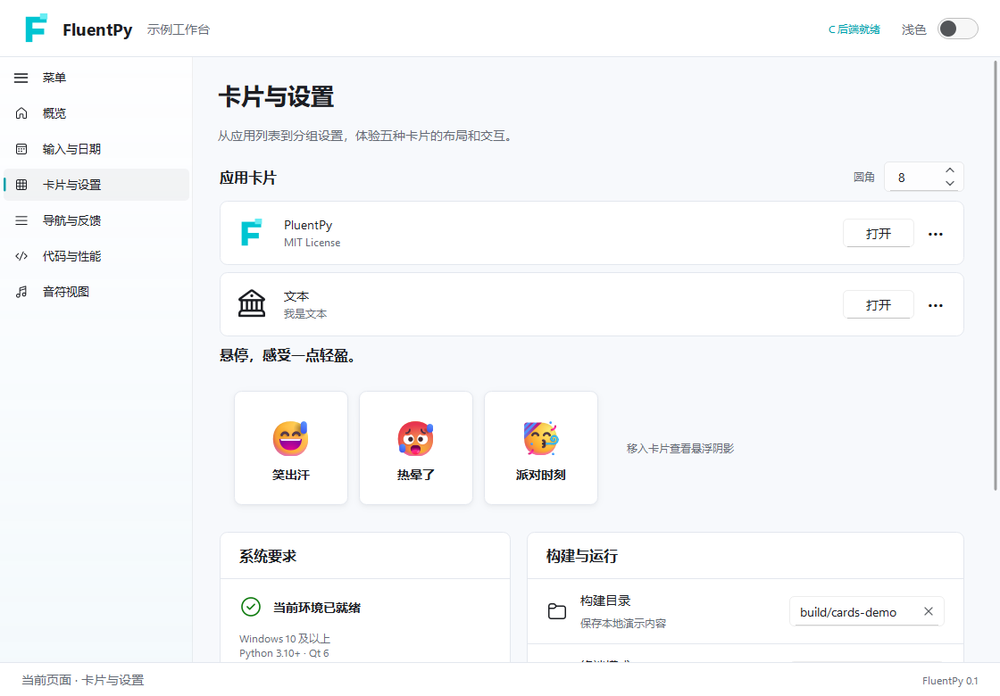
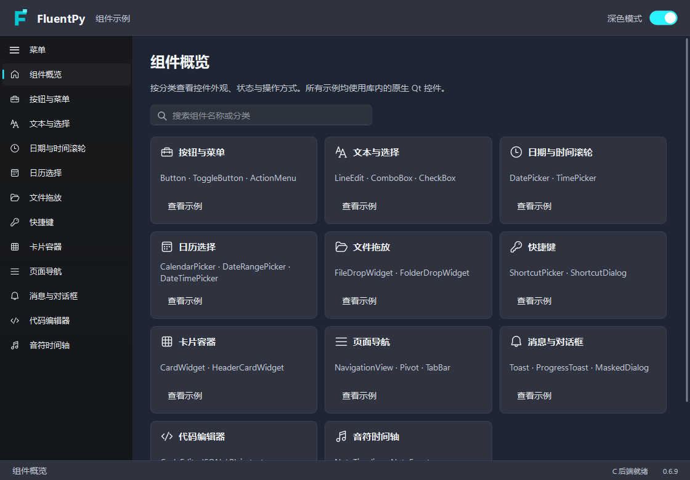

# FluentPy

**面向 Qt for Python 的 Fluent 风格桌面组件库。**

FluentPy 是面向 Qt for Python 的 Fluent 风格组件库，由 **性邓的小馒头** 独立开发，采用 [MIT 许可证](LICENSE)。从输入框、卡片和日期滚轮，到带动画的导航、代码编辑器和消息浮层，可以逐个使用，也可以组合成完整工作台。

界面由 Qt 控件、绘制与动画实现；计算密集的后端逐步交给 C 扩展。默认使用 PySide6，保留 PyQt6 适配入口。当前版本为 **0.6.9**，仍处于早期开发阶段。

[官方文档](https://fluentpy.mcxmcl.cn/) · [文档源码](https://github.com/XDDXMT/FluentPy-Docs) · [快速开始](#快速开始) · [组件与示例](#组件与示例) · [C 后端与性能](#c-后端与性能) · [问题反馈](https://github.com/XDDXMT/FluentPy/issues)

## 界面展示

组件示例程序按 12 个页面组织：组件概览、按钮与菜单、文本与选择、日期与时间滚轮、日历选择、文件拖放、快捷键、卡片容器、页面导航、消息与对话框、代码编辑器和音符时间轴。概览支持按组件名称筛选，各页直接展示对应控件的状态和操作。



<details>
<summary>查看深色主题</summary>



</details>

工作台直接使用库内的 `NavigationView`、`NavigationSidebar` 和 `AnimatedStackedWidget`：侧栏展开与收起、选中指示条和页面切换都有动画。Pivot 与文档标签连接实际内容，支持编辑、新建、关闭和保留各页输入。

卡片保持常规桌面尺寸，主题统一管理颜色和字体；卡片本身是容器，操作交给内部按钮。组件示例采用 Microsoft Fluent 图标和统一的标题、内容与参数区，主图标与文档站一致。

## 快速开始

需要 **Python 3.10+**。下面以 Windows PowerShell 为例，从本仓库安装到独立环境：

```powershell
git clone https://github.com/XDDXMT/FluentPy.git
cd FluentPy
python -m venv .venv
.\.venv\Scripts\python.exe -m pip install -e .
```

安装时会尝试构建可选C扩展。默认优先使用C；扩展缺失、无法加载或缺少某个组件的接口时，该组件自动回退到Python兼容后端。**日期／时间滚轮、三种日历选择器、拖放、快捷键选择器和CodeEdit都能在没有C扩展时使用**，无需为运行这些组件安装编译器。需要启用C加速时，再完成下面的构建步骤。

已有兼容当前 Python 的系统 C 编译器时：

```powershell
.\.venv\Scripts\python.exe -m pip install "setuptools>=77"
.\.venv\Scripts\python.exe -B scripts/build_native.py
.\.venv\Scripts\python.exe examples/showcase.py
```

Windows x64 没有安装 MSVC，也可以使用仓库提供的独立 Zig 工具链：

```powershell
.\.venv\Scripts\python.exe -B scripts/fetch_zig.py
.\.venv\Scripts\python.exe -B scripts/build_native.py --zig .toolchains/zig-x86_64-windows-0.14.1/zig.exe
.\.venv\Scripts\python.exe examples/showcase.py
```

下载器从 Zig 官方站点获取固定版本并校验 SHA-256，约 82 MB，文件与缓存留在项目目录。原生扩展必须匹配当前 Python 小版本、系统和架构。更多选项见 [C 后端构建与打包](docs/native-build.md)。

以上安装针对本仓库，无需从 PyPI 安装同名项目。当前实际验证环境是 **Windows x64、CPython 3.13、PySide6 / Qt 6.11.1**；其他环境需要自行验证。Windows 系统材质不可用时，窗口使用普通背景。

### 写下第一个窗口

在已安装 FluentPy 的 Python 环境中运行：

```python
import sys

from fluentpy import AccentButton, FluentWindow, Toast
from fluentpy.qt import QtWidgets

app = QtWidgets.QApplication(sys.argv)
window = FluentWindow("我的 FluentPy 应用")

save = AccentButton("保存")
save.clicked.connect(
    lambda: Toast.success(
        "已保存",
        detail="可以继续下一步。",
        target=save,
        parent=window,
    )
)
window.content_layout.addWidget(save)
window.show()

sys.exit(app.exec())
```

控件继续使用 Qt 的信号、布局和事件机制。`Toast` 可指向触发按钮，也可放在窗口四角；仅传标题时使用紧凑的单行提示，并带入场与退场动画。

## 组件与示例

| 类别 | 主要组件与能力 |
| --- | --- |
| 按钮 | 普通／强调／透明图标、状态切换与胶囊筛选、下拉／拆分操作、`LoadingButton` 与动画 `ActionMenu` |
| 输入与选择 | `LineEdit`、`SearchLineEdit`、`PasswordLineEdit`、`TextEdit`、`RichTextEdit`、下拉框、数值输入、复选框和单选按钮 |
| 日期与时间 | `DatePicker`与`TimePicker`日期／时间滚轮；`CalendarPicker`日历、`DateRangePicker`日期区间、`DateTimePicker`日历与时分秒，支持禁用日期、页内动画与C／Python双后端 |
| 拖放 | `FileDropWidget`、`FolderDropWidget`、`DropArea`：浏览与拖入本地路径、类型过滤、多选和后台校验 |
| 快捷键 | `ShortcutPicker`、`ShortcutDialog`：组合键录制、键帽预览、保存／重置／取消与冲突提示 |
| 代码编辑 | `CodeEdit`：JSON 高亮、行号、当前行、缩进引导、字体设置与 C 扫描后端 |
| 卡片与设置 | `CardWidget`、`SimpleCardWidget`、`ElevatedCardWidget`、`HeaderCardWidget`、`GroupHeaderCardWidget` |
| 导航 | `NavigationView`、`NavigationSidebar`、`AnimatedStackedWidget`、`BreadcrumbBar`、`Pivot`、分段控件、`TabBar` |
| 反馈与状态 | `Toast`、`ProgressToast`：四角任务进度、未知进度、完成／失败、悬停暂停；`ToggleSwitch`、`Slider`、`ProgressBar` |
| 窗口与容器 | `FluentWindow`、无边框对话框、页内遮罩对话框、`FluentScrollBar`、`Card`、`ExamplePanel` |
| 音符视图 | `NoteTimeline`、`NoteEvent`：单轨／多轨概览、配色、进度游标与时间定位 |
| 主题与资源 | 浅色／深色主题、强调色、统一字体、106 个 Microsoft Fluent System Icons |

独立 Demo 适合只看一个组件。在已安装依赖的环境中，从仓库根目录运行：

| 示例 | 运行命令 | 说明 |
| --- | --- | --- |
| 组件示例程序 | `python examples/showcase.py` | 12 个组件分类页面；`--dark` 启动深色，`--page calendar` 直达日历选择 |
| 按钮与菜单 | `python examples/buttons.py` | 状态过渡、互斥筛选、页内菜单、拆分操作、加载保护与键盘操作 |
| 拖放文件 | `python examples/drop.py` | 文件／文件夹、浏览、后台校验与路径结果；C优先，Python兼容 |
| 快捷键选择器 | `python examples/shortcut_picker.py` | 页内录制、冲突提示与窗口内快捷键触发；C优先，Python兼容 |
| 带说明复选框 | `python examples/checkbox.py` | Other files／760.0 KB；可选第二行、整项点击、键盘和主题 |
| 卡片 | `python examples/cards.py` | 应用条目、表情悬浮卡片、标题与分组设置 |
| 日期选择器 | `python examples/date_picker.py` | 三列滚轮、空值、回填和日期范围；C优先，Python兼容 |
| 时间选择器 | `python examples/time_picker.py` | 24／12小时制、AM／PM、独立滚轮、页内弹层和清空；C优先，Python兼容 |
| 日历与日程 | `python examples/calendar_picker.py` | 单日、日期区间、日期时间、月／年视图、禁用端点、圆弧区间底色与平滑动画 |
| 代码编辑器 | `python examples/code_editor.py` | 编辑 JSON，查看高亮与缩进引导 |
| 消息浮层 | `python examples/toast.py` | 紧凑消息、带箭头消息、位置与动画 |
| 任务进度提示 | `python examples/progress_toast.py` | 四角定位、平滑进度、循环条、完成／失败和悬停暂停 |
| 性能对照 | `python examples/text_performance.py` | 完整 1k／10k／50k 行 JSON，对照原始版本、Python 与 C |
| 音符时间轴 | `python examples/note_timeline.py` | 单轨、多轨、空状态与进度演示 |

Windows 也可使用 `examples/run_showcase.bat` 及对应组件的 `run_*.bat`。音符时间轴负责可视化，文件解析和声音播放由应用处理。

接口与用法：[按钮与菜单](docs/buttons.md) · [快捷键选择器](docs/shortcut-picker.md) · [任务进度提示](docs/progress-toast.md) · [拖放组件](docs/drag-drop.md) · [卡片](docs/cards.md) · [日期选择器](docs/date-picker.md) · [时间选择器](docs/time-picker.md) · [日历与日程](docs/calendar-picker.md) · [代码编辑器](docs/code-editor.md) · [音符时间轴](docs/note-timeline.md)

## C 后端与性能

Python 负责公开接口、Qt 交互和 C 绑定，C 扩展负责已接入的计算路径，目前包括：

- **JSON 词元扫描与 UTF-16 位置映射**：供 `CodeEdit` 高亮使用，缺少扩展时可回退 Python。
- **日期运算**：供 `DatePicker` 处理日历与日期范围。
- **时间运算**：供 `TimePicker` 校验时／分、转换12／24小时制、计算独立滚轮和AM／PM候选。
- **日历与日程**：供三种日历组件生成42格公历、限制与禁用策略、日期平移、区间端点规范化、日期时间夹紧和时分秒候选。
- **拖放选择策略**：规范化后缀、过滤类型、批量去重和限制选择数量。
- **快捷键策略**：组合合法性、修饰键顺序与占用冲突检查。

以上路径均以C为首选加速实现，同时提供行为兼容的Python回退。旧版扩展缺少某组接口时，仅该组回退；仍然有效的C接口继续使用。

启用 C 后端无需替换前端组件类名。可以查看编辑器实际使用的后端：

```python
from fluentpy import CodeEdit

editor = CodeEdit()  # 在 QApplication 创建后使用
editor.set_code('{"project": "FluentPy", "enabled": true}')
print(editor.acceleration_backend())  # native 或 python
```

`FLUENTPY_BACKEND=auto`默认优先C并自动回退；`python`强制使用Python兼容实现；`native`明确要求C，在对应接口不可用时给出构建提示。这三种模式统一作用于文本、日期、时间、拖放和快捷键。`native_available()`检查二进制是否具备相应能力，组件的`acceleration_backend()`返回实际选择的`native`或`python`。详见[后端选择与回退](docs/backends.md)。

以下为同一台 Windows x64 电脑、AMD Ryzen 9 9950X3D、CPython 3.13.1、Qt 6.11.1 的历史实测。10,000 行取五轮、50,000 行取三轮独立进程中位数，均处理完整输入。

| 数据量 | 测量项目 | 原始版本 | C 后端 | 加速比 |
| --- | --- | ---: | ---: | ---: |
| 10,000 行 JSON | JSON 逐行扫描 | 25.28 ms | 1.91 ms | 13.21× |
| 10,000 行 JSON | 完整载入与首帧 | 64.93 ms | 42.73 ms | 1.52× |
| 50,000 行 JSON | JSON 逐行扫描 | 127.21 ms | 10.73 ms | 11.85× |
| 50,000 行 JSON | 完整载入与首帧 | 292.60 ms | 180.12 ms | 1.62× |

扫描的加速比只适用于扫描路径。文档创建、排版、绘制和交互仍有各自开销，整库不会因此获得相同倍数的提升。万行 JSON 应放入多行的 `CodeEdit`，而不是单行 `LineEdit`。

[完整结果与测量方法](docs/performance.md) · [10k 原始报告](benchmarks/text-performance-10000.json) · [50k 原始报告](benchmarks/text-performance-50000.json) · [构建说明](docs/native-build.md)

## 本地文档

仓库附带中文文档站，提供分类组件目录、名称筛选、接口搜索与图标搜索。简介先展示实际组件示例程序，再用 JS 动画演示 Qt → FluentPy 输入框过渡以及 Python → C → Qt 的处理流程；支持暂停和重播。组件页将“示例与用法”和“API 参考”分开，代码与 GIF 按需展开，常见问题逐项阅读。网页跟随系统主题，组件媒体保持亮色。

从仓库根目录启动静态服务：

```powershell
python -m http.server 8767 --bind 0.0.0.0 --directory sites/fluentpy-docs/dist
```

浏览器打开 [本地文档](http://127.0.0.1:8767/#/introduction)。也可双击 `sites/fluentpy-docs/启动本地文档.bat`；局域网设备使用服务器实际 IP 访问。重新生成接口和截图的方法见 [文档站说明](sites/fluentpy-docs/README.md)。

文档网站的源码、完整静态页面和控件媒体也在独立的 [FluentPy-Docs](https://github.com/XDDXMT/FluentPy-Docs) 仓库以 MIT 许可公开。只预览或部署网站无需安装 Qt；重新提取 API 或录制控件时，通过 `FLUENTPY_SOURCE_ROOT` 指向本组件库源码。

## 开发与验证

```powershell
python -m pip install -e ".[dev]"
python -m pytest
```

常规行为测试可在无C环境运行；完整C／Python差分测试需要当前解释器对应的C扩展。测试包含日期边界、缺失／不兼容／旧扩展的独立进程、实际录制与拖放、组件生命周期、快速导航和动画中断。构建原生／纯Python wheel和源码包的方法见[打包说明](docs/native-build.md)。

| 目录 | 内容 |
| --- | --- |
| `src/fluentpy/` | Python 接口、Qt 控件、主题与 SVG 资源 |
| `native/` | C文本、日期、时间、拖放与快捷键策略 |
| `examples/` | 工作台与独立 Demo |
| `docs/`、`sites/fluentpy-docs/` | Markdown 文档、图片与本地文档站 |
| `tests/` | 正确性、生命周期与交互测试 |
| `scripts/`、`benchmarks/` | 构建工具、性能复现脚本与报告 |

后续后端运算以C作为首选加速实现，并维护可用的Python兼容路径；Python同时保持公开接口、绑定和Qt界面逻辑。扩展缺失不能导致组件不可用，详见[开发约定](AGENTS.md)。

欢迎通过 [Issues](https://github.com/XDDXMT/FluentPy/issues) 提交问题与建议。使用场景可参考 [FluentMelody](https://github.com/XDDXMT/FluentMelody)。

## 许可证与资源来源

FluentPy 自身源码采用 **MIT**：允许使用、修改、分发和商用，保留版权声明与许可证文本即可；软件按原样提供。完整条款见 [LICENSE](LICENSE)。

组件在本仓库独立实现。微软图标来自 [Microsoft Fluent UI System Icons](https://github.com/microsoft/fluentui-system-icons)，保留其 MIT 许可证与来源记录。Qt、PySide6 和可选 PyQt6 适配依赖分别遵循各自许可证。

[第三方声明](THIRD_PARTY_NOTICES.md) · [图标许可证](licenses/Microsoft-Fluent-System-Icons-LICENSE.txt) · [图标来源](src/fluentpy/assets/icons/SOURCE.md) · [实现与许可边界](docs/licensing-boundaries.md)
