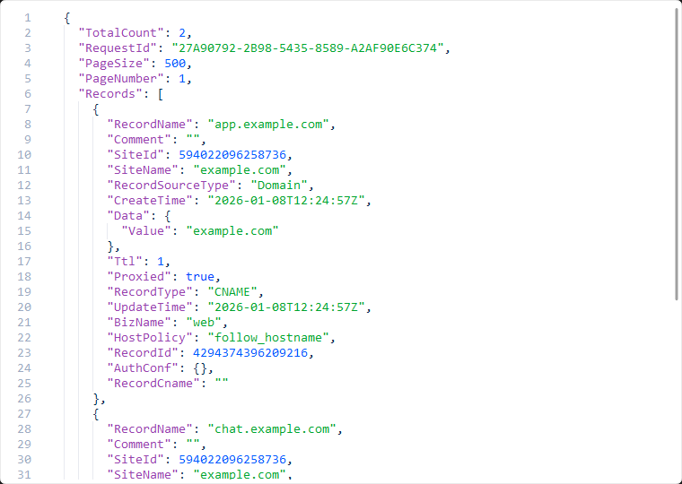
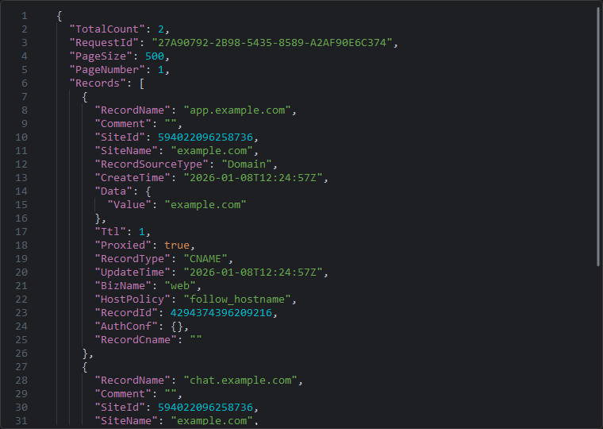

# CodeEdit 代码编辑框

独立运行示例：

```powershell
python examples/code_editor.py
```

Windows 也可双击 `examples/run_code_editor.bat`。示例默认浅色，支持切换深色、编辑内容及还原示例。

示例已改为嵌套的 JSON 响应数据，并使用两空格缩进。需要展开查看时可运行 `python examples/code_editor.py --large`；也可以加 `--dark` 以深色启动。默认启动尺寸保持不变。

示例按控件自身的 `sizeHint()` 自动确定初始尺寸，不再单独放大窗口。本机推荐编辑区域为 **258×202**，最小尺寸 **160×80**，单位为逻辑像素；外层窗口另包含边距、状态文字和按钮。默认代码字号跟随创建时的主题字号，目前为 **14px**。窗口可以拖动边缘调整大小，编辑区域随布局伸缩。

以下截图使用 **760×540** 的展示尺寸，以便查看多层 JSON 和缩进辅助线；这不会改变控件的默认推荐尺寸。运行 `python examples/capture_code_editor.py` 可重新生成。





`CodeEdit` 提供同步滚动的行号、缩进辅助线、聚焦时的当前行背景、JSON 语法高亮、等宽字体与聚焦底线动画。浅色模式使用深紫色键名（#9640AD）、绿色字符串、蓝色数字和布尔值；深色模式使用柔和紫色键名、绿色字符串、青色数字与橙色布尔值。长行横向滚动；Tab 默认按四空格缩进，Shift+Tab 取消缩进，Enter 延续当前缩进。支持原生选择、复制粘贴、撤销和重做。

```python
from fluentpy import CodeEdit

# 在已有 QApplication 环境中创建。
editor = CodeEdit(language="json")
# 可选：自定义编辑区域尺寸与代码字号。
# 在父布局中使用时，实际宽高由布局分配。
editor.resize(480, 300)
editor.set_font_size(16)
editor.set_indent_size(2)
editor.set_code('{"name": "FluentPy", "enabled": true}')
editor.textChanged.connect(lambda: print(editor.code()))
```

- `set_code()` / `code()`：设置／读取纯文本；也提供 Qt 风格的 `setPlainText()` / `toPlainText()`。
- `set_language("json" | "plain")`：切换 JSON 高亮或普通文本，保留内容、光标和撤销记录。
- `set_font_size(pixels)` / `font_size()`：设置／读取代码字号，行号同步调整，切换主题时保留自定义值。
- `set_indent_size(spaces)` / `indent_size()`：设置／读取缩进宽度，默认 4；Tab、Shift+Tab、Enter 和辅助线保持同步，不自动重新排版已有文本。
- `setReadOnly()` / `isReadOnly()`：设置／查询只读状态。
- `acceleration_backend()`：读取当前 JSON 高亮器实际选用的 `native` 或 `python` 后端。已编译 C 扩展时自动启用，缺失时回退；详见[性能实测](performance.md)。
- `text_edit`：底层 `QPlainTextEdit`，可调用 `textCursor()`、`setTextCursor()`、`document()` 等 Qt 接口。

当前只提供 JSON 和普通文本。语法着色不会校验 JSON，也不包含补全、折叠、文件读写或运行代码功能。高亮不修改原始内容，非 BMP 字符（例如 emoji）使用 Qt 的 UTF-16 位置处理。
