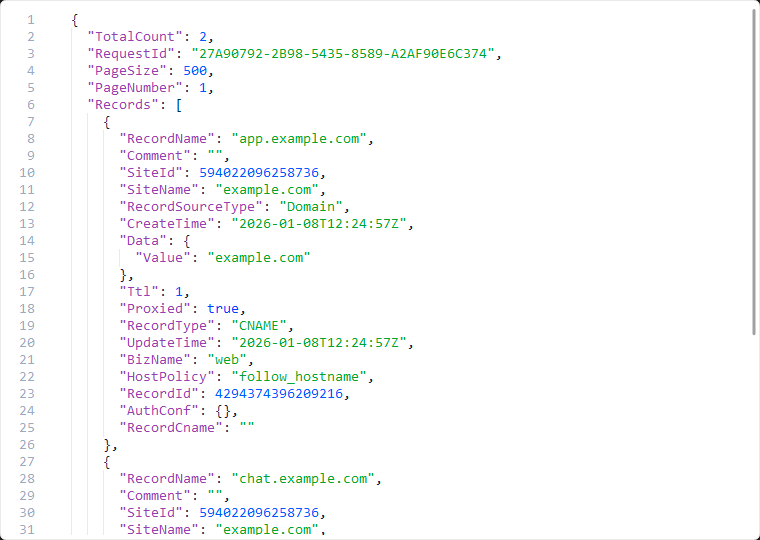
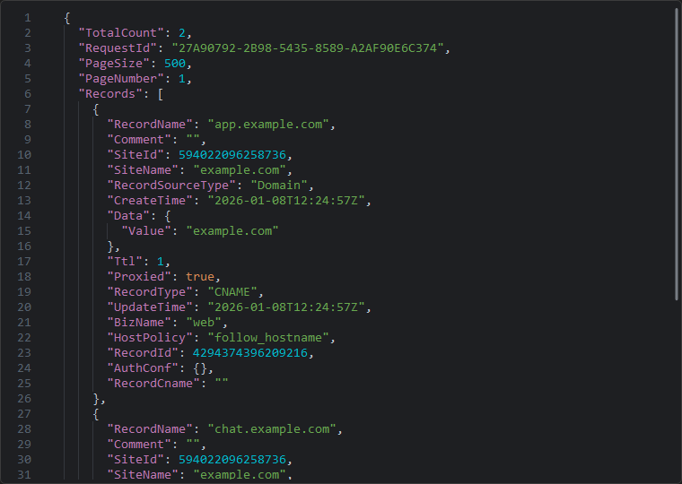

# CodeEdit 代码编辑框

独立运行示例：

```powershell
python examples/code_editor.py
```

Windows 也可双击 `examples/run_code_editor.bat`。示例默认浅色，支持切换深色、编辑内容及还原示例。

示例已改为嵌套的 JSON 响应数据，并使用两空格缩进。需要展开查看时可运行 `python examples/code_editor.py --large`；也可以加 `--dark` 以深色启动。默认启动尺寸保持不变。

示例按控件自身的 `sizeHint()` 自动确定初始尺寸，不再单独放大窗口。本机推荐编辑区域为 **258×202**，最小尺寸 **160×80**，单位为逻辑像素；外层窗口另包含边距、状态文字和按钮。默认代码字号跟随创建时的主题字号，目前为 **14px**。窗口可以拖动边缘调整大小，编辑区域随布局伸缩。

以下截图使用 **760×540** 的展示尺寸，以便查看多层 JSON 和缩进辅助线；这不会改变控件的默认推荐尺寸。运行 `python examples/capture_code_editor.py` 可重新生成。





`CodeEdit` 提供同步滚动的行号、缩进辅助线、聚焦时的当前行背景、多语言语法高亮、等宽字体与聚焦底线动画。浅色模式使用深紫色键名（#9640AD）、绿色字符串、蓝色数字和布尔值；深色模式使用柔和紫色键名、绿色字符串、青色数字与橙色布尔值。长行横向滚动；Tab 默认按四空格缩进，Shift+Tab 取消缩进，Enter 延续当前缩进。支持原生选择、复制粘贴、撤销和重做。

```python
from fluentpy import CodeEdit

# 在已有 QApplication 环境中创建。
editor = CodeEdit(language="json")
# 可选：自定义编辑区域尺寸与代码字号。
# 在父布局中使用时，实际宽高由布局分配。
editor.resize(480, 300)
editor.set_font_size(16)
editor.set_indent_size(2)
editor.set_code('{"name": "FluentPy", "enabled": true}')
editor.textChanged.connect(lambda: print(editor.code()))
```

- `set_code()` / `code()`：设置／读取纯文本；也提供 Qt 风格的 `setPlainText()` / `toPlainText()`。
- `set_language(language)`：选择 Python、Java 等内置语言或普通文本，保留内容、光标和撤销记录。
- `set_font_size(pixels)` / `font_size()`：设置／读取代码字号，行号同步调整，切换主题时保留自定义值。
- `set_indent_size(spaces)` / `indent_size()`：设置／读取缩进宽度，默认 4；Tab、Shift+Tab、Enter 和辅助线保持同步，不自动重新排版已有文本。
- `setReadOnly()` / `isReadOnly()`：设置／查询只读状态。
- `acceleration_backend()`：读取当前高亮器实际选用的 `native`、`python` 或 `custom` 后端。已编译 C 扩展时自动启用，缺失时回退；详见[性能实测](performance.md)。
- `text_edit`：底层 `QPlainTextEdit`，可调用 `textCursor()`、`setTextCursor()`、`document()` 等 Qt 接口。

当前提供 17 种模式：plain、json、python、java、javascript、typescript、c、cpp、csharp、go、rust、sql、html、xml、css、yaml、shell。支持 py、js、ts、c++、c#、yml、bash 等别名。语法着色不会校验 JSON，也不包含补全、折叠、文件读写或运行代码功能。高亮不修改原始内容，非 BMP 字符（例如 emoji）使用 Qt 的 UTF-16 位置处理。


## 选择语言与扩展分词器

多语言接口自 0.8.0 起提供。切换语言只改变格式，不替换文档、代码、光标或撤销记录；独立示例的“还原示例”会显式载入所选语言的示例文本。

```python
from fluentpy import CodeEdit

editor = CodeEdit(language="python")
editor.set_code('def greet(name: str):\n    return f"Hello, {name}"')
editor.set_language("java")
print(editor.supported_languages())
```

Python 三引号、C/Java 块注释、JavaScript 模板字符串、HTML/XML 注释与跨行属性使用 Qt block state 延续状态。着色采用容错词法扫描，处理尚未输入完整的代码；不提供完整语法树或语言服务器。JSON 保留原有规则与颜色。

新增扫描由 `native/syntax_accel.c` 实现。缺少对应 C 接口时，auto 模式只对该扫描回退到 Python，不影响旧扩展仍可加速的其他功能。`FLUENTPY_BACKEND=native` 要求当前扫描接口可用，配置错误在进入 Qt 高亮回调前报告。

```python
from fluentpy import SyntaxToken


def color_block_as_comment(text, previous_state):
    width = len(text.encode("utf-16-le", errors="surrogatepass")) // 2
    return [(0, width, SyntaxToken.Comment)], 0


editor.set_token_provider(color_block_as_comment)
editor.highlightingError.connect(print)
editor.set_token_provider(None)
```

分词器接收当前块文本和上一块状态，返回 `(spans, next_state)`。span 为 `(UTF-16 起点, 长度, SyntaxToken)`，状态为非负 32 位整数。自定义分词器异常或无效范围通过 `highlightingError` 信号报告，`syntax_highlighter().last_error()` 可读取详情；界面不会执行源代码。分词器在文档所属线程运行，应避免阻塞操作。

`SyntaxHighlighter(document, language="python")` 也可直接连接已有 `QTextDocument`，无需使用 CodeEdit 或工作台。`set_colors()` 接受按 token 名称设置的完整颜色字典。公共枚举 SyntaxToken 包含键、字符串、数字、字面量、关键字、注释、运算符、函数、类型、标签、属性、装饰器与变量。
