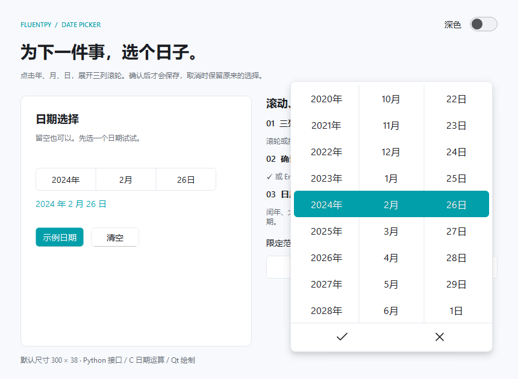

# DatePicker 日期选择器

点击「年／月／日」展开三列日期滚轮。中间整行使用主题强调色，底部 ✓ 确认、× 取消。初始状态为空，打开时临时定位到今天；确认前不修改已经保存的日期。



## 单独运行

在仓库根目录执行：

```powershell
python -B scripts/build_native.py --zig .toolchains/zig-x86_64-windows-0.14.1/zig.exe
python examples/date_picker.py
```

没有本地工具链时先执行 `python -B scripts/fetch_zig.py`；已有系统 C 编译器可用 `python -B scripts/build_native.py`。详见[编译说明](native-build.md)。Windows 也可双击 `examples/run_date_picker.bat`。`--dark` 从深色启动，`--open` 启动后直接打开主选择器。

新的完整[示例工作台](../examples/showcase.py)可用 `python examples/showcase.py` 或 `examples/run_showcase.bat` 运行，包含日期表单及其他现有组件。旧 `gallery.py` 已移除。

## 使用

在已有 QApplication 的环境中：

```python
from fluentpy import DatePicker
from fluentpy.qt import QtCore

picker = DatePicker()
picker.set_date(QtCore.QDate(2024, 2, 26))
picker.dateChanged.connect(lambda date: print(date.toString("yyyy-MM-dd")))
picker.dateAccepted.connect(lambda date: print("确认", date.toString("yyyy-MM-dd")))
```

`dateChanged` 仅在已提交的日期实际变化时发出，清空时传入无效 QDate。`dateAccepted` 在点击确认或按 Enter 时发出，即使确认的是原值。滚动、点击候选行、取消、Esc 及点击外部都不会提前提交。

## 尺寸与范围

- 默认推荐尺寸为 300 × 38，最小推荐尺寸为 240 × 34；放入布局后可横向伸缩。
- 默认范围为 1900-01-01 至 2100-12-31，可用 `set_date_range()` 修改，C 后端支持公历 1 至 9999 年。
- `set_date()` 接收 QDate，超出范围时夹到最近边界；无效 QDate 等同于 `clear()`。
- 年月改变后，日自动调整到有效日期。例如 2024-02-29 切到 2025 年，变为 2025-02-28。
- 月、日在当前允许区间内循环；年到范围边界停止，不通过月或日的循环改变其他列。

```python
picker.set_date_range(QtCore.QDate(2024, 2, 1), QtCore.QDate(2024, 2, 29))
picker.clear()
print(picker.date().isValid())  # False：尚未选择
picker.show_popup()
```

也提供 `setDate()`、`setMinimumDate()` 和 `setMaximumDate()`，便于沿用 Qt 风格调用。`minimum_date()`、`maximum_date()` 返回当前边界。

## 交互与后端

滚轮、触控板、垂直拖动和点击候选行均可选择日期。左右方向键切换列，上下键逐项选择，PageUp / PageDown 跳五项；Enter 确认、Esc 取消。浮层按当前屏幕可用区域定位，支持明暗主题与自定义强调色。

公历闰年、大小月、日期夹紧、范围限制、步进和滚轮候选值优先使用C计算。默认auto模式在扩展缺失、无法加载或缺少日期接口时自动切换到Python兼容实现，日期选择器仍然可以打开、滚动和确认。`picker.acceleration_backend()`返回实际选择的`native`或`python`；强制`FLUENTPY_BACKEND=native`才会在缺少扩展时报错。见[后端选择与回退](backends.md)。

现有 JSON 的性能报告仍是文本后端当次测量快照，不代表日期选择器的加速倍率。
