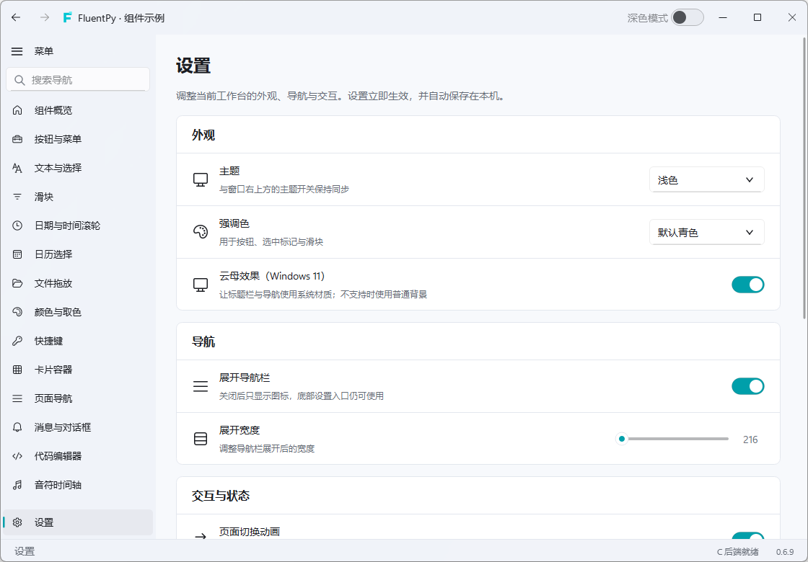

# 流畅窗口

`FluentWindow` 继承原生 `QMainWindow`。原有 `content_layout` 与系统标题栏继续可用；需要多页应用时，再注册页面、选择导航布局，或显式启用可扩展标题栏。

独立示例：`python examples/fluent_window.py`。示例使用真实 Qt 页面：项目概览、可编辑说明、活动记录和底部设置，默认启用自定义标题栏和云母效果。加上 `--native-title-bar` 可体验默认的系统标题栏，`--mode compact` 或 `--mode top` 可直接选择导航布局。示例设置中可切换云母与配对实色背景。

## 从普通窗口开始

```python
from fluentpy import FluentWindow, LineEdit
from fluentpy.qt import QtWidgets

app = QtWidgets.QApplication([])
window = FluentWindow("项目工作区")
window.content_layout.addWidget(LineEdit("项目名称"))
window.show()
app.exec()
```

没有注册页面时，不创建导航栏。第一次调用 `navigation_view()` 或 `add_page()` 才创建导航容器，并把它加入原有内容布局；应用已经放入的控件不会被替换。

## 注册页面与底部设置

每个页面是普通 `QWidget`，页面内可以继续使用 Qt 布局、输入框和现有 FluentPy 控件。路由在同一窗口内必须唯一。

```python
from fluentpy import FluentIcon, fluent_icon, CheckBox

overview = QtWidgets.QWidget()
overview_layout = QtWidgets.QVBoxLayout(overview)
overview_layout.addWidget(QtWidgets.QLabel("项目概览"))
window.add_page(overview, "概览", fluent_icon(FluentIcon.HOME), route="overview", position="header")

document = QtWidgets.QWidget()
document_layout = QtWidgets.QVBoxLayout(document)
editor = QtWidgets.QPlainTextEdit()
document_layout.addWidget(editor)
window.add_page(
    document, "项目说明", fluent_icon(FluentIcon.DOCUMENT), route="documents", position="scroll"
)

settings = QtWidgets.QWidget()
settings_layout = QtWidgets.QVBoxLayout(settings)
dark_mode = CheckBox("深色主题")
dark_mode.toggled.connect(window.set_dark)
settings_layout.addWidget(dark_mode)
settings_layout.addStretch()
window.add_page(
    settings, "设置", fluent_icon(FluentIcon.SETTINGS), route="settings", position="bottom"
)
```

`header` 位于侧栏顶部固定区，`scroll` 位于中间滚动区，`bottom` 位于底部固定区；`top` 是原有滚动入口的位置别名。可以继续用 `window.navigation_view().sidebar.set_header_widget(...)` 放置搜索框，或使用 `set_footer_widget(...)` 放置账户等普通控件。

设置页只是应用自己的页面，窗口不会替用户创建设置项或保存业务数据。需要重启后恢复配置时，由应用使用 `QSettings` 等存储方式管理。

## 同一组页面，四种布局

```python
window.set_navigation_mode("auto")
window.set_navigation_width(224)
window.set_navigation_breakpoint(880)
```

| 布局 | 行为 |
| --- | --- |
| `auto` | 宽度达到断点时展开侧栏，较窄时切换为紧凑图标栏。 |
| `expanded` | 固定使用展开侧栏。 |
| `compact` | 固定使用紧凑侧栏。 |
| `top` | 隐藏侧栏，使用现有 `Pivot` 在页面上方组织路由；入口较多时允许横向滚动。 |

`navigation_mode()` 读取配置的模式。默认断点为 880 逻辑像素；`set_navigation_width` 的最小值是 120，`set_navigation_breakpoint` 的最小值是 320。切换布局复用同一批页面和控件，保留当前编辑内容。

## 路由、历史和页面生命周期

```python
window.switch_to("documents")
window.switch_to(overview, animated=False)
if window.can_go_back():
    window.go_back()
if window.can_go_forward():
    window.go_forward()

window.currentChanged.connect(lambda route: print("当前路由", route))
window.historyChanged.connect(lambda: print("可返回", window.can_go_back()))
```

- `current_route()` 返回当前路由，`current_page()` 返回当前页面；未创建页面导航时分别为 `""` 和 `None`。
- `switch_to(route_or_widget, animated=True)` 接受路由或已注册控件，返回是否成功切换。不可见或未知路由返回 `False`。
- `go_back()`／`go_forward()` 返回是否成功移动。返回后进入另一页面，会清除原来的前进分支。
- `navigation_view().set_route_visible(route, False)` 隐藏入口。隐藏、移除或销毁页面后，历史会排除失效路由。
- `remove_page(route, delete=False)` 从导航容器移除页面；设置 `delete=True` 时同时按 Qt 生命周期释放。应用应清理页面自己创建的后台任务或外部资源。
- `add_sub_interface(...)`、`addSubInterface(...)` 与 `switchTo(...)` 保留兼容入口，和对应的窗口方法共用同一组页面与历史。

## 可扩展标题栏

自定义标题栏默认关闭。启用后使用一行式标题栏：返回、图标、标题和窗口按钮处在同一行，背景跟随明暗主题，不再叠加一行普通系统标题栏。Windows 保留系统边框能力，由 DWM 处理圆角与阴影，并使用系统移动、边缘缩放及窗口操作。

```python
from fluentpy import SearchLineEdit, Button

window.set_title_bar_enabled(True)
title_bar = window.title_bar()
search = SearchLineEdit("搜索项目")
search.setFixedWidth(220)
title_bar.content_layout.addWidget(search)
title_bar.button_layout.addWidget(Button("帮助"))
title_bar.set_double_click_enabled(True)
# 默认 48；需要更多空间时可调整，窗口按钮同步高度。
title_bar.set_bar_height(56)
```

默认创建的 `FluentTitleBar` 高 48 逻辑像素，包含窗口图标、自动省略的标题、前进／后退与最小化／最大化／关闭按钮。`set_bar_height(...)` 调整标题栏与按钮高度，`bar_height()` 读取配置；切换主题或重新启用标题栏会保留自定义高度。标题与图标跟随窗口变化，历史按钮随路由历史更新；背景、标题文字与按钮前景同步当前明暗主题和窗口背景配置。标题栏与窗口内的导航侧栏共用外壳表面；默认实色外壳与主内容背景保持分层。

窗口按钮由 Qt 绘制为 Windows 风格的细线符号：关闭按钮悬停显示红底白色 X，其他按钮使用中性色背景；按钮执行实际窗口操作，不将它们称为系统绘制的非客户区控件。搜索框、标签栏等放入 `content_layout`，额外操作放入 `button_layout`；两者都是普通 `QHBoxLayout`，自定义控件保留输入、焦点和按钮行为。

标题栏的空白与标题区域可拖动，双击可最大化／还原；`set_double_click_enabled(False)` 关闭双击操作。`set_caption_buttons_visible(minimize=True, maximize=True, close=True)` 控制窗口按钮，最大化按钮隐藏或禁用时，双击也不会最大化。前进、后退和窗口操作按钮均为既有按钮控件，可通过公开属性调整。

`uses_native_caption_buttons()` 区分系统绘制的窗口操作与一体式 Qt 标题栏。在 Windows 上，未启用自定义标题栏的普通窗口使用系统窗口按钮；一体式模式返回 `False`。圆角与阴影由当前桌面系统决定，最大化时保持系统的直角边界，不绘制额外的假阴影。

最大化和全屏时关闭外层圆角与可见边线，恢复普通窗口后重新使用系统圆角、边框和阴影。最大化遵循显示器工作区，完整全屏才覆盖任务栏区域。导航主内容保留 10px 左上圆角，以露出标题栏／侧栏共用的外壳表面；该裁剪只作用于子页面容器，不给原生窗口设置遮罩。侧栏展开状态、当前页面和输入内容在窗口状态切换时保留。

也可以独立创建 `FluentTitleBar(owner)`，交给 `window.set_title_bar(custom_bar)`；此方法会接管新标题栏并启用自定义模式。`set_title_bar_enabled(False)` 恢复系统标题栏，保留标题栏对象与自定义控件，以便再次启用。`is_title_bar_enabled()` 读取状态。

## 整窗主题过渡

普通 `FluentWindow` 默认关闭主题过渡，可按需启用；示例工作台默认已开启。切换明暗模式时，将完整窗口的旧画面与更新后的画面进行 280ms 渐变，一体式标题栏、窗口按钮和内容区一起过渡。

```python
from fluentpy import theme

window.set_theme_transition_enabled(True)
theme.set_mode("dark")

# 同时更改模式与强调色时，也可一次提交。
theme.set_theme("light", accent="#0078d4")
print(window.is_theme_transition_enabled())
```

连续反转主题会从当前混合画面接续。输入、点击、滚轮或拖动会让界面回到实时控件；如果该操作本身切换主题，则由新一轮过渡接续。缩放窗口、隐藏、关闭或改变窗口状态时取消过渡并释放缓存帧。启用云母时，短暂的缓存过渡使用对应主题的中性外壳颜色，结束后恢复系统实时合成的材质。主题和强调色各自的原有接口仍可用，`set_theme(...)` 适合需要一起更新两者的操作。

## 明暗背景与云母效果

```python
window.set_background_colors("#edf4fa", "#162231")
# 跟随 FluentPy 默认主题背景：
window.clear_background_colors()

# 可选：让窗口外壳使用 Windows 11 原生云母。
window.set_backdrop_enabled(True)
window.show()
print(window.is_backdrop_enabled())
print(window.backdrop_applied())
window.backdropChanged.connect(lambda applied: print("实际材质状态", applied))
```

背景颜色必须是有效、不透明的颜色，分别用于全局主题的浅色与深色模式；它们也作为外壳的实色配置与云母不可用时的背景。`clear_background_colors()` 恢复默认配色：标题栏与侧栏同色，主内容区使用另一层背景。`set_dark(...)` 仍切换 FluentPy 的全局主题，不是独立的每窗口主题。

普通 `FluentWindow` 默认关闭云母，调用 `set_backdrop_enabled(True)` 后请求 DWM 的主窗口云母材质，并让标题栏、导航侧栏等外壳表面露出该材质。工作台与独立窗口示例默认开启；工作台可在“设置 → 外观 → 云母效果（Windows 11）”中切换，偏好会自动保存。工作台的主内容保持不透明背景，让材质集中在窗口外壳。

云母需要 Windows 11 build 22621 或更新版本、DWM 合成与系统透明效果可用；高对比度模式、平台不支持或原生调用失败时使用普通 Qt 背景。材质由 Windows 根据壁纸与主题合成，初次开启会由系统逐渐呈现，失焦或部分系统策略下可能显示中性色；它不是实时模糊窗口后方的其他应用。

以下为独立测试窗口的 Windows 实际合成截图，外壳色调会随壁纸和系统状态变化：



`is_backdrop_enabled()` 读取应用请求；`backdrop_applied()` 表示当前原生请求成功，且 Qt 外壳已让出材质表面。`backdropChanged(bool)` 在实际状态改变时发出，适合让附加的外壳控件同步背景。实际状态不保证每时每刻都带有明显的壁纸色调；窗口显示前或系统回退时可能为 `False`，请求偏好仍会保留。

通过 `FluentWindow.add_page(...)` 创建的导航内容区默认铺设独立的不透明主题背景，普通页面无需自行填充背景。直接使用 `content_layout` 时，无背景的自定义布局可以露出材质；需要实色内容面时，可用普通页面控件承载布局并调用 `page.setAutoFillBackground(True)`，其 `QPalette.Window` 使用窗口主题背景。自定义绘制或样式表应自行保持所需的不透明表面，库不会替应用改写页面样式。

本实现参考[公开的流畅窗口交互分类](https://qfluentwidgets.com/zh/pages/components/fluentwindow/)，独立组合现有 Qt 控件与 FluentPy 导航；未复制参考页面的源码、样式、截图或示例文案。
