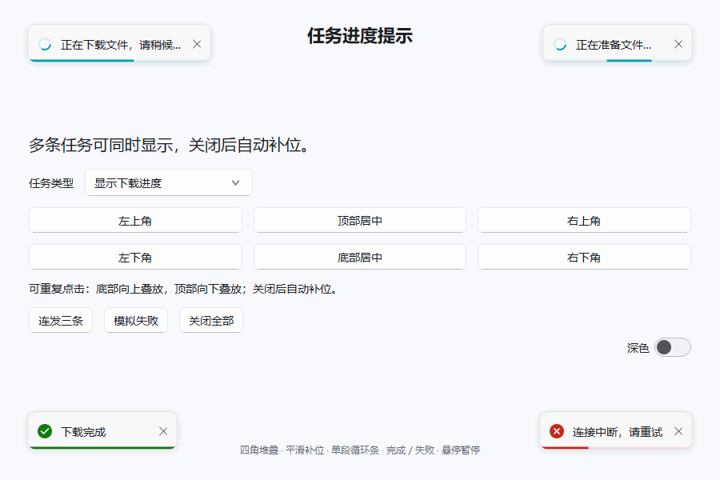
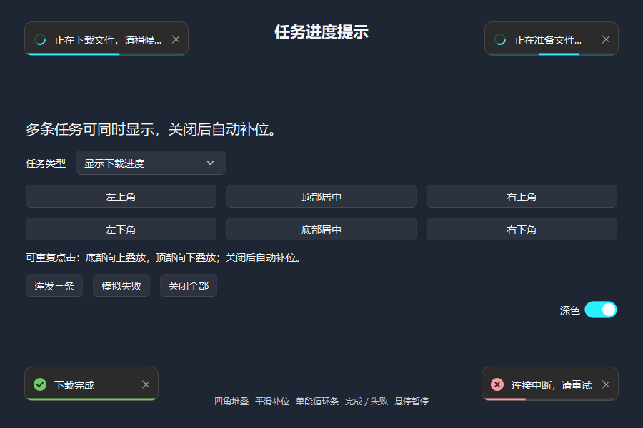

# 任务进度提示

`ProgressToast` 是带进度的原生 Qt 消息卡片。任务运行时显示进度或循环条，完成／失败后在同一张卡片内切换图标、颜色和文字，卡片宽度沿当前角落平滑调整。

```python
from fluentpy import ProgressToast

notice = ProgressToast.start(
    "正在下载文件，请稍候…",
    parent=window,
    placement="bottom-right",
)
notice.set_progress(35)  # 0–100；只有显示效果，不实际下载文件
notice.finish("下载完成", timeout_ms=1800)
```

`placement` 支持 `top-left`、`top-center`、`top-right`、`bottom-left`、`bottom-center`、`bottom-right`。传入父窗口后在窗口内部绘制，普通缩放和移动会跟随定位，不创建额外原生提示窗口。单行卡片默认可见最小约187×47逻辑像素，字体14px；文字较长时自动调整尺寸并换行。明暗主题和强调色实时生效。

## 未知进度与失败

同一窗口同一角落可连续创建多条提示，Toast 与 ProgressToast 混合排列：最新提示靠近锚定角落，底部向上、顶部向下延伸，关闭后以240ms平滑补位。各窗口与角落独立管理；空间不足时移除最旧条目，保留新消息。指定 target 的带箭头提示继续跟随目标，不加入角落堆叠。

```python
for index in range(4):
    ProgressToast.start(
        "正在下载文件中，请稍候…",
        parent=window,
        placement="bottom-right",
        indeterminate=True,
        severity="warning",
    )
```

`severity="warning"` 显示琥珀色状态图标与进度线；默认 `info` 保留主题强调色。单段移动进度线、完成／失败和自动关闭的行为保持一致。

```python
notice = ProgressToast.start("正在准备文件…", parent=window, indeterminate=True)
# 知道总量后可直接转为确定进度。
notice.set_progress(60)
# 失败时停止循环，默认保留到手动关闭。
notice.fail("连接中断，请重试", timeout_ms=0)
```

`set_indeterminate(True)` 切换到循环条；轨道内始终只有一段实心线，长度为当前轨道宽度的30%，在两端平滑往返，不拆成首尾两段。`set_progress(value)` 自动切回确定进度。有限数值限制在0–100，NaN和无穷值拒绝；设置100不会自动宣告任务成功，应用确认任务完成后再调用 `finish()`。`set_title(text)` 更新任务文案。终态后的延迟进度或重复完成通知不会覆盖已呈现的结果。

## 动画与停留

- 340ms侧滑淡入、220ms淡出，进度更新用220ms缓动，宽度变化用240ms缓动，状态图标与颜色交叉过渡200ms。
- `finish()`默认完成后停留1800ms；倒计时在入场结束后开始，鼠标悬停时暂停，离开后继续。`timeout_ms=0`表示手动关闭。
- `fail()`默认不自动关闭；可传入超时毫秒数。运行中的提示不设置超时。
- 点击关闭、父窗口隐藏／最小化／销毁时停止动画和计时器。`start()`创建的对象关闭后自动释放。自行构造 `ProgressToast(...).show_at(...)` 时，生命周期由应用管理。

信号：`progressChanged(float)`表示目标进度变化，`stateChanged(str)`为`success`或`error`，`finished(bool)`表示本次任务成功或失败。每个任务只进入一次终态。工作线程可用Qt信号连接`notice.set_progress`，槽函数会在界面线程更新；不要在工作线程直接操作控件。

这是界面呈现组件，动画使用Qt原生动画系统；下载、解析和后端计算由应用执行，本组件不宣称增加C后端运算加速。

独立Demo：`python examples/progress_toast.py`，或双击`examples/run_progress_toast.bat`。示例使用Qt时间轴模拟4.2秒任务，可以测试四角、连续点击／连发三条、未知进度、失败和全部关闭。工作台的“消息与对话框”页复用同一演示。




