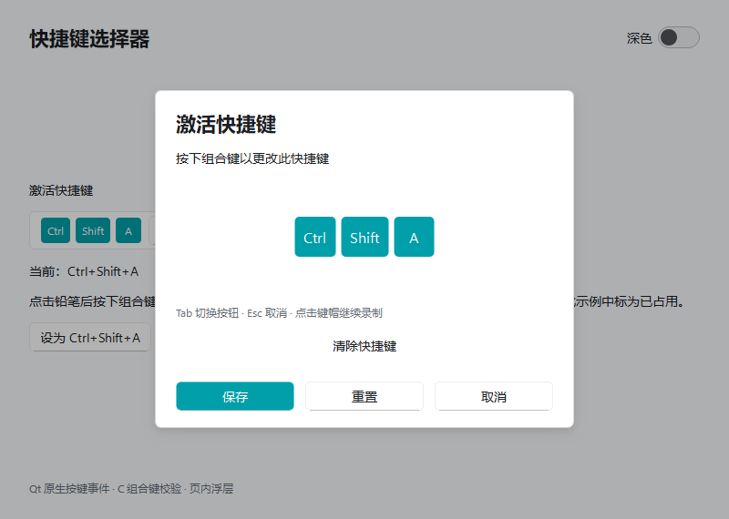
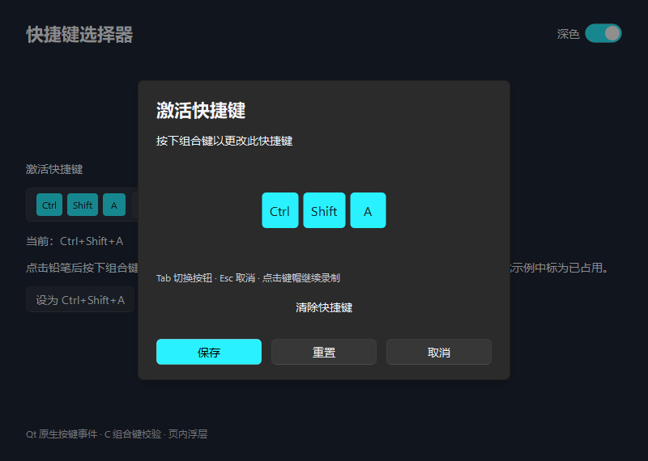

# 快捷键选择器

`ShortcutPicker`用键帽显示一个组合键，点击铅笔打开页内录制浮层。按键实时预览，保存后回填；重置恢复打开时的组合，取消保留原值，清除后可保存为空。

```python
from fluentpy import ShortcutPicker

picker = ShortcutPicker("Ctrl+Shift+A", parent=window)
picker.sequenceChanged.connect(print)  # PortableText字符串
window.content_layout.addWidget(picker)
picker.set_key_sequence("Alt+L")
picker.set_reserved_sequences(["Ctrl+S", "Ctrl+O"])
```

接口接受Qt `QKeySequence`或PortableText字符串。一次录制一个组合，支持修饰键、功能键、方向键等；不支持`Ctrl+K, Ctrl+C`这种连续多步组合。程序设置非法或冲突组合会报错。冲突列表由应用提供，编辑时冲突会禁用保存；空组合不参与冲突。

`key_sequence()`返回QKeySequence副本；`set_key_sequence()`设置值；`clear()`清空；`open_editor()`打开录制；`reserved_sequences()`返回占用列表副本。兼容`keySequence()`和`setKeySequence()`。信号为`keySequenceChanged(QKeySequence)`与`sequenceChanged(str)`，仅在提交的值变化时发送。

录制区获得焦点时接收组合键，包括Enter和Ctrl+Tab。单独修饰键只预览，长按重复忽略。普通Tab／Shift+Tab在录制区和按钮间移动焦点，Esc取消；按钮获得焦点后Enter执行对应操作，点击键帽可继续录制。录制时抑制所属窗口的Qt快捷键，关闭后恢复；不拦截其他窗口。

控件隐藏、禁用、销毁或父窗口关闭时取消未保存内容。浮层是父窗口子控件，不创建独立原生弹窗。独立使用`ShortcutDialog`时可传初值、父窗口和`reserved_sequences`，通过`accepted`和`key_sequence()`取得结果。

选择器不自动注册全局热键。连接窗口内动作可使用Qt接口：

```python
from fluentpy.qt import QtGui

action = QtGui.QShortcut(picker.key_sequence(), window)
action.activated.connect(lambda: print("快捷键触发"))
picker.keySequenceChanged.connect(action.setKey)
```

组合合法性、修饰键顺序、ASCII字母规范化和占用冲突优先使用`native/shortcut_accel.c`。默认auto模式在扩展缺失、无法加载或缺少快捷键接口时使用Python兼容策略，录制、冲突检查和保存继续可用。Qt负责按键事件和QKeySequence转换。`picker.acceleration_backend()`读取实际后端，`FLUENTPY_BACKEND`统一支持auto／python／native。参见[后端选择与回退](backends.md)和[C构建说明](native-build.md)。

运行`python examples/shortcut_picker.py`或双击`examples/run_shortcut_picker.bat`。Demo保存后可实际触发当前窗口的Qt快捷键；工作台“快捷键”页复用相同演示。默认窗口800×570，紧凑键帽高28、录制键帽高44、浮层最大宽460，均为Qt逻辑像素。




