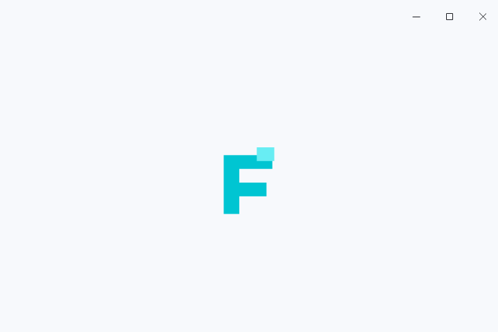

# 启动页面

`SplashScreen` 是放在现有 Qt 窗口内的启动遮罩。默认只显示居中的应用图标，窗口顶部只保留最小化、最大化／还原和关闭按钮；初始化结束后调用 `finish()`，遮罩在 220ms 内渐隐，露出原有页面并恢复完整标题栏。不会创建额外原生窗口，也不运行嵌套事件循环。



## 使用

```python
from fluentpy import FluentWindow, SplashScreen
from fluentpy.qt import QtGui, QtWidgets

app = QtWidgets.QApplication([])
window = FluentWindow("我的应用")
window.set_title_bar_enabled(True)
window.setWindowIcon(QtGui.QIcon("app.svg"))

splash = SplashScreen(window.windowIcon(), window)
splash.set_icon_size(102)
splash.show()
window.show()

# 启动异步初始化任务，完成信号连接 splash.finish。
# 在主线程创建、更新 Qt 控件；耗时工作交给工作线程。
app.exec()
```

构造时保持隐藏，需要显式调用 `show()`。可在显示主窗口之前创建并显示遮罩；初始化任务应在事件循环能响应时执行。连接任务的完成信号到 `splash.finish` 后，退场结束会发出一次 `finished()`。本组件不规定应用的初始化任务或线程模型。

```python
splash.set_text("正在准备界面…")
splash.set_loading(True)

# 初始化完成，在 GUI 线程调用：
splash.finish()
# 需要立即结束时：splash.finish(animated=False)
```

图标可用 `QIcon`、`QPixmap`、`FluentIcon` 或文件路径；省略图标时读取所属窗口的图标。尺寸可用正整数或 `QSize`，在窄窗口内会自动缩小以保持内容位于可用区域。可选加载环与提示默认关闭，空文字不占空间。

## 窗口与生命周期

- 必须提供 `QWidget` 父控件；可覆盖整个窗口内容，也可放在局部预览容器内。全窗口启动时，`FluentTitleBar` 只保留三个窗口操作，标题、图标、历史和自定义控件临时隐藏，背景与启动页一致；结束后恢复原有内容、可见状态与最新标题。局部预览不改变外层标题栏。普通 Qt 宿主的系统标题栏仍由系统管理。
- 显示时覆盖原有内容并拦截被覆盖区域的输入；退场结束后移除输入过滤、停止加载动画并恢复此前的焦点。内容控件、输入值和窗口透明度保持不变。局部预览中可用 Tab 移至覆盖范围外的配置控件。
- `finish()` 可重复调用，不会重启动画或重复发送完成信号；结束后可 `show()` 重播。父窗口隐藏时停止动画与输入过滤，完成渐隐期间隐藏或最小化不会在还原后重新出现；所属父控件销毁时按 Qt 所有权释放。
- 使用 `set_background_colors(light, dark)` 指定不透明的配对背景，`clear_background_colors()` 恢复主题背景。原生云母仍由窗口管理，启动遮罩使用自己的实色背景。

## 示例入口

工作台每次启动都会先显示此页面，顶部只保留三个窗口操作。第一帧绘制后才检查后端并逐页创建界面，每批之间返回 Qt 事件循环；全部页面与交互就绪后立即渐隐，没有固定等待或虚构进度。`--dark`、`--page` 和截图入口均经过同一启动流程；截图在实际就绪和退场完成后生成。关闭窗口会取消剩余初始化，初始化异常会在启动页显示实际错误。

工作台 **页面导航 → 启动页面** 仍提供图标大小、可选加载提示、重播与全窗口预览。只有手动重播和独立组件示例使用约 1.5 秒的演示计时。

独立示例：`python examples/splash_screen.py`，或双击 `examples/run_splash_screen.bat`。可加 `--dark`。工作台和独立示例的编辑内容在重播后保留。

仅参考[公开启动页面的布局和交互](https://qfluentwidgets.com/zh/pages/components/splashscreen/)，独立使用 FluentPy 图标、Qt 绘制、事件过滤与动画实现，未复制参考项目的代码、资源或截图。
