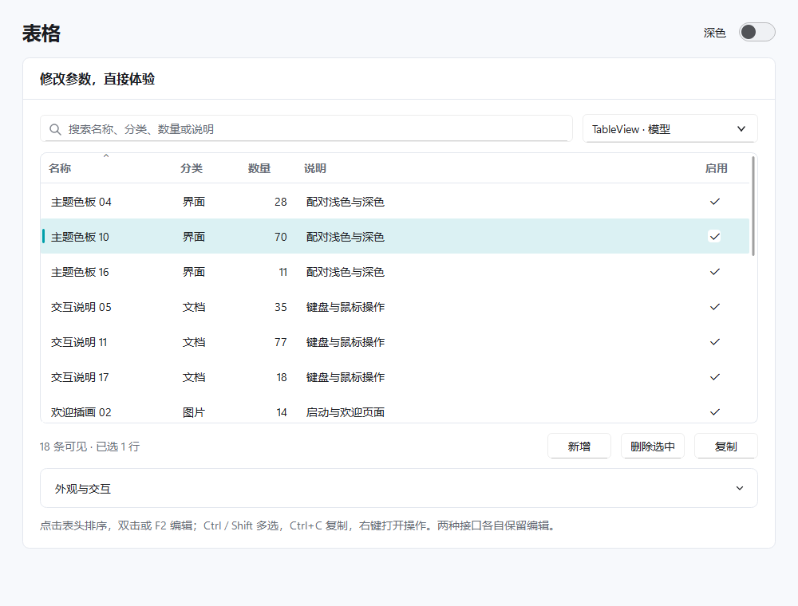

# 表格

`TableView` 与 `TableWidget` 分别继承 Qt 的 `QTableView`、`QTableWidget`。保留 Qt 模型、项目、选择、排序和编辑接口；普通行、圆角行、细线行共用同一组件配置，不需要替换一套控件。

工作台侧栏 **表格** 提供实时搜索、添加、删除、多选复制和收起的外观设置。独立运行 `python examples/tables.py` 或双击 `examples/run_tables.bat`；可加 `--dark`。



## 项目表格

```python
from fluentpy import TableWidget
from fluentpy.qt import QtCore, QtWidgets

table = TableWidget(2, 2, window)
table.setHorizontalHeaderLabels(["名称", "数量"])
table.setItem(0, 0, QtWidgets.QTableWidgetItem("图标资源"))
quantity = QtWidgets.QTableWidgetItem()
quantity.setData(QtCore.Qt.ItemDataRole.DisplayRole, 12)
table.setItem(0, 1, quantity)
table.setItem(1, 0, QtWidgets.QTableWidgetItem("项目模板"))
table.setItem(1, 1, QtWidgets.QTableWidgetItem("待填写"))
table.setSortingEnabled(True)
window.content_layout.addWidget(table)
```

数值以 `DisplayRole` 的整数／浮点数存储，Qt 才会按数值排序。`'12'` 是字符串，按文本比较。`TableWidget(parent)` 与 `TableWidget(rows, columns, parent)` 都可使用；适合小规模、直接管理项目的界面。

## 模型视图与原生筛选

```python
from fluentpy import TableView, SearchLineEdit
from fluentpy.qt import QtCore, QtGui

source = QtGui.QStandardItemModel(0, 2, window)
source.setHorizontalHeaderLabels(["名称", "分类"])
source.appendRow([QtGui.QStandardItem("主题色板"), QtGui.QStandardItem("界面")])
source.appendRow([QtGui.QStandardItem("使用说明"), QtGui.QStandardItem("文档")])

proxy = QtCore.QSortFilterProxyModel(window)
proxy.setSourceModel(source)
proxy.setFilterKeyColumn(-1)
proxy.setFilterCaseSensitivity(QtCore.Qt.CaseSensitivity.CaseInsensitive)

view = TableView(window)
view.setModel(proxy)
view.setSortingEnabled(True)
search = SearchLineEdit("搜索全部列")
search.textChanged.connect(proxy.setFilterFixedString)
window.content_layout.addWidget(search)
window.content_layout.addWidget(view)
```

模型由调用方管理生命周期，建议给模型设置合适的 Qt 父控件。组件不会接管源数据或添加隐藏的 Python 数据副本；排序、筛选和选择交给 Qt。较多数据优先使用 `TableView` 与已有模型。

示例的两种接口各自保留自己的编辑数据。模型视图使用 `QSortFilterProxyModel`；项目表格使用 Qt 的 `findItems` 与行隐藏来演示搜索，清空搜索不会删掉数据。

## 外观与选择

```python
table.set_row_style("rounded")  # standard / rounded / line
table.set_row_height(44)  # 至少 24；可用 36 / 44 / 52 调整密度
table.setAlternatingRowColors(True)
table.set_border_visible(True)
table.set_border_radius(8)
table.verticalHeader().setVisible(False)
table.set_select_right_clicked_row(True)
```

默认按行多选，支持 Ctrl、Shift、方向键和 Qt 的选择模式。右键点击已选区域保留多选，点击未选中的可用条目则选中目标；关闭右键选中后，右键不改变当前选择。模型的可用／可选标记继续生效。

圆角裁剪只作用于表格的内部表面，不给原生窗口设置区域。悬停和选择使用两个共用的 120ms 动画；只为可见单元绘制，不为每格创建 QWidget。隐藏、滚动、模型重置或替换会清理悬停状态；隐藏时停止动画与自身菜单。

## 编辑与自定义代理

双击或 F2 编辑。字符串、整数、浮点数分别复用现有 `LineEdit`、`SpinBox`、`DoubleSpinBox`；其余类型沿用 Qt 编辑器工厂。Enter 提交、Escape 取消，数值保留对应 Qt 类型。模型的 `FontRole`、`ForegroundRole`、`BackgroundRole`、图标和 `CheckStateRole` 继续使用。

```python
from fluentpy import TableItemDelegate


class ProjectDelegate(TableItemDelegate):
    def createEditor(self, parent, option, index):
        editor = super().createEditor(parent, option, index)
        # 在这里为具体列补充验证器、范围或领域专用编辑器。
        return editor


table.setItemDelegate(ProjectDelegate(table))
table.setEditTriggers(table.EditTrigger.NoEditTriggers)
```

`NoEditTriggers` 禁止弹出单元格编辑器；可勾选项仍由 Qt 模型的 `ItemIsUserCheckable` 和 `ItemIsEnabled` 标记管理。浮点编辑器按原值保留精度和数量级；非有限值或超过 Qt 323 位小数范围的值不打开默认编辑器。业务范围、精度和校验规则由调用方代理指定。

## 复制、空状态与右键

```python
table.set_empty_text("暂无记录")
text = table.selection_text(include_headers=True)
copied = table.copy_selection(include_headers=True)
```

Ctrl+C 复制选区。文本按可见行列顺序输出 TSV，保留稀疏选区空位，对单元中的 Tab、换行和引号使用标准引用；隐藏行列不输出。没有选择时不改剪贴板。`include_headers=True` 包含表头。

独立表格的右键菜单复用 `ActionMenu`，提供复制、含表头复制、编辑和全选。`createStandardContextMenu()` 只生成 QAction 容器，供工作台的既有高级菜单适配器复用，不弹出第二套系统菜单。编辑中的输入框继续使用自身编辑动作。

仅参考[公开表格示例的布局和交互分类](https://qfluentwidgets.com/zh/pages/components/tableview/)，独立使用 Qt 模型视图、FluentPy 现有控件和主题实现；未引入参考项目的代码、样式表、图片或示例数据。
