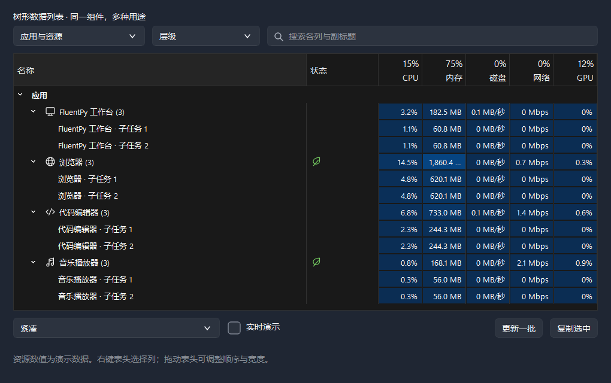

# 树形数据列表

`TreeTableView` 连接已有 Qt 模型；`TreeTableWidget` 提供直接添加、查找和更新条目的接口。它们共用列配置、绘制代理、主题、键盘操作与高级右键菜单，可以用于资源浏览、任务、设备、游戏实例和监控数据。

本页接口自 0.8.0 起提供。安装组件库后即可在业务应用中导入；从源码运行 `python examples/tree_tables.py` 可体验完整示例，工作台侧栏也有独立的 **树形列表** 入口。`examples/tree_table_minimal.py` 仅导入已安装的 fluentpy 和标准库，可直接作为业务应用的起点，不依赖工作台模块。



## 直接添加条目

```python
from fluentpy import TreeColumn, TreeCell, TreeTableWidget, FluentIcon

tree = TreeTableWidget(
    [
        TreeColumn("name", "名称", width=260, stretch=True),
        TreeColumn("status", "状态", kind="badge"),
        TreeColumn("progress", "进度", kind="progress", formatter=lambda value: f"{value:.0f}%"),
        TreeColumn("action", "操作", width=90, kind="action"),
    ],
    window,
)
project = tree.append_item({"name": "示例项目"}, key="project", group=True)
tree.append_item(
    {
        "name": TreeCell(
            "准备资源", icon=FluentIcon.FOLDER, subtitle="支持文字、图标、说明与勾选状态"
        ),
        "status": "进行中",
        "progress": 42.0,
        "action": "暂停",
    },
    parent=project,
    key="download",
)
tree.expandAll()
window.content_layout.addWidget(tree)
```

`values` 接受按列顺序的序列，或以列 `key` 为键的字典。`append_item` 返回名称列的 `QStandardItem`。`parent` 接受源条目或其唯一键；多级子项按相同方式添加。`group=True` 设置分组外观，其余列仍可显示汇总文字。

列 `kind` 支持 `text`、`badge`、`progress`、`action`。`heat=True` 独立添加数值热度底色；`minimum`、`maximum` 设置进度和热度的视觉范围。超出范围的显示比例限制在 0 到 1；空值、非数值与非有限数值不绘制数值填充，源值保持不变。

`TreeCell` 可配置图标、副标题、提示、单元格类型、颜色、勾选状态与编辑标志。`FluentIcon` 单色图标随主题着色；普通 `QIcon` 或图片保留原色。双行内容自动使用至少 52px 行高，单行可用 `set_row_height(32)` 调整密度。

叶子是公共 SVG 资源，可使用 `fluent_icon(FluentIcon.LEAF)` 取得 QIcon，传给任何 Qt 按钮、标签或单元格。它随 wheel 分发，独立应用同样可调用；其来源记录在图标目录的 `SOURCE.md`。

## 原始数据、排序与显示

```python
from fluentpy import TreeColumn
from fluentpy.qt import QtCore

memory_column = TreeColumn(
    "memory",
    "内存",
    width=130,
    alignment=QtCore.Qt.AlignmentFlag.AlignRight | QtCore.Qt.AlignmentFlag.AlignVCenter,
    formatter=lambda value: f"{value / 1024**2:,.1f} MB",
    heat=True,
    maximum=4 * 1024**3,
)
```

格式化发生在绘制与复制时，模型仍保存原始字节数。默认按 `DisplayRole` 中的整数／浮点数排序。需要独立排序值时，配置 `TreeColumn.sort_role`，在源模型提供对应角色；`TreeFilterProxyModel` 会在排序该列时使用它。其他外部代理保留调用方的策略。排序在每个父项内部进行，不改变层级。

列 `editable=True` 设置直接添加条目的默认编辑标志；外部模型由自己的 Qt flags 决定。双击或 F2 编辑，文本和数值沿用 FluentPy 编辑器。

## 搜索与局部更新

需要整列全局排序时，使用 `tree.set_sort_mode("flat")`；`tree.set_flat_sorting_enabled(True)` 可让点击表头自动切换为平铺排序。平铺包含当前已加载的全部后代，不受折叠状态影响，分组标题不参与数值排序。使用 `tree.set_sort_mode("hierarchical")` 返回层级，恢复之前的展开状态。工作台三个场景均采用点击表头自动平铺的方式，并提供“层级／平铺”入口。外部模型可通过公开的 `TreeFlattenProxyModel` 连接 Qt 排序代理，不需要使用工作台代码。

```python
tree.set_filter_text("资源")
tree.set_filter_text("")

with tree.batch_update():
    tree.update_item("download", {"progress": 65.0, "status": "进行中"})

tree.set_header_summary("progress", "65%")
```

搜索为不区分大小写的字面匹配，覆盖原始列值与副标题；匹配子项时显示其父级路径，匹配父项时保留子项。搜索时展开结果，清空后恢复搜索前的展开、选择和滚动位置。需要正则或专用条件时，使用代理的 Qt 接口或继承代理。

`update_item` 修改现有项目，不重建整棵树。普通值只更新 `DisplayRole`；`TreeCell` 替换单元格的元数据。唯一键可定位当前被过滤掉的条目。`remove_item` 删除整棵子树，`clear_items` 清空数据并保留列定义。

`batch_update` 合并绘制与代理的动态排序，支持嵌套，异常后恢复设置；源模型信号正常发送。增量编辑和插入保留 Qt 持久索引、选择和展开，批次结束保留滚动条位置。重排可能改变当前可见条目；需要冻结顺序时使用代理的 `setDynamicSortFilter(False)`，恢复后显式调用 `invalidate()`。整模型 reset 仍遵守 Qt 的重置语义。

大量单行数据可设置 `tree.setUniformRowHeights(True)`，让 Qt 复用行高，减少批量更新时的布局计算。含副标题的双行条目与大小不同的自定义单元格保留默认的可变行高。工作台资源监控场景采用固定行高，项目任务场景保留可变行高。

汇总由使用者显式提供，组件不假设数值可相加。设备在线数、下载总速度、项目统计均可使用相同的两行表头接口。

## 接入已有 Qt 模型

```python
from fluentpy import TreeColumn, TreeTableView, TreeFilterProxyModel
from fluentpy.qt import QtCore, QtGui

source = QtGui.QStandardItemModel(window)
source.setHorizontalHeaderLabels(["文件", "大小"])
folder = QtGui.QStandardItem("文档")
source.appendRow([folder, QtGui.QStandardItem()])
size = QtGui.QStandardItem()
size.setData(8192, QtCore.Qt.ItemDataRole.DisplayRole)
folder.appendRow([QtGui.QStandardItem("使用说明.md"), size])

proxy = TreeFilterProxyModel(window)
proxy.setSourceModel(source)
view = TreeTableView(
    [
        TreeColumn("name", "文件", width=250, stretch=True),
        TreeColumn("size", "大小", formatter=lambda value: f"{value:,} B"),
    ],
    window,
)
view.setModel(proxy)
view.expandAll()
window.content_layout.addWidget(view)
```

`setModel` 保持 Qt 通常语义，不隐式包装或接管外部模型。无需筛选时可直接连接源模型。懒加载使用模型的 `canFetchMore` / `fetchMore`，拖放使用 Qt 的模型 MIME、flags 和视图设置，选择使用标准 selectionModel。模型修改在界面线程执行；工作线程通过信号交回采集结果。

`TreeRole` 是可选扩展角色：名称列上的 `Key`、`Group`，单元格上的 `Subtitle`、`CellKind`、`Color`、`IconTint`，以及表头的 `Summary`。普通模型无需提供这些角色。`TreeTableWidget.source_model` 与 `proxy_model` 可直接使用；替换整个模型时使用 `TreeTableView`。

## 业务动作与自定义单元格

```python
from fluentpy import TreeRole


def handle_action(index):
    key = index.siblingAtColumn(0).data(TreeRole.Key)
    print("操作条目", key)


tree.cellActionTriggered.connect(handle_action)


def extend_menu(menu, index):
    if index.isValid():
        action = menu.addAction("查看详情")
        action.triggered.connect(lambda: print(index.siblingAtColumn(0).data()))


tree.contextMenuAboutToShow.connect(extend_menu)
```

操作单元格通过鼠标点击、Enter 或空格发出 `cellActionTriggered`，禁用条目不会触发。索引始终属于当前显示的模型，代理用 `mapToSource` 映射。菜单扩展信号传入 QAction 容器 `QMenu`，最终由现有 `ActionMenu` 展示；可结合 `selectionModel()` 加入批量操作。异步回调使用 `QPersistentModelIndex` 或业务键保存目标。

特殊绘制或编辑器可继承 `TreeItemDelegate`，使用 `setItemDelegateForColumn` 替换某列；也可使用标准 `QStyledItemDelegate`、`openPersistentEditor` 和 `setIndexWidget`。默认仅绘制可见单元格，不为每格创建 QWidget；大量数据优先使用代理，少量长期交互的单元格再使用真实控件。

右键表头可隐藏列，名称所在树列保持可见；表头支持移动、调整宽度和排序。Ctrl+C 按可见行列顺序复制 TSV，隐藏列、折叠子项与隐藏行不会输出。行样式 `standard` / `rounded` / `line` 与列分隔线均可独立配置。

`set_visual_style("windows")` 使用独立的 Windows 表格表面：深色黑灰背景、灰色选择与蓝色热度，浅色使用白色背景与暖色热度；`"fluent"` 恢复 FluentPy 默认表面。样式仅作用于当前列表。资源演示提供 CPU、内存、磁盘、网络与 GPU 列，名称列显示层级与图标，状态列使用图标。

默认展开／收起即时改变层级布局，箭头用共享的 120ms 动画表达方向，悬停与选择继续渐变；默认不启用 Qt 的整段子树截图动画。点击箭头不修改当前选中项，键盘左右方向键与双击名称仍保留 Qt 的层级操作。
